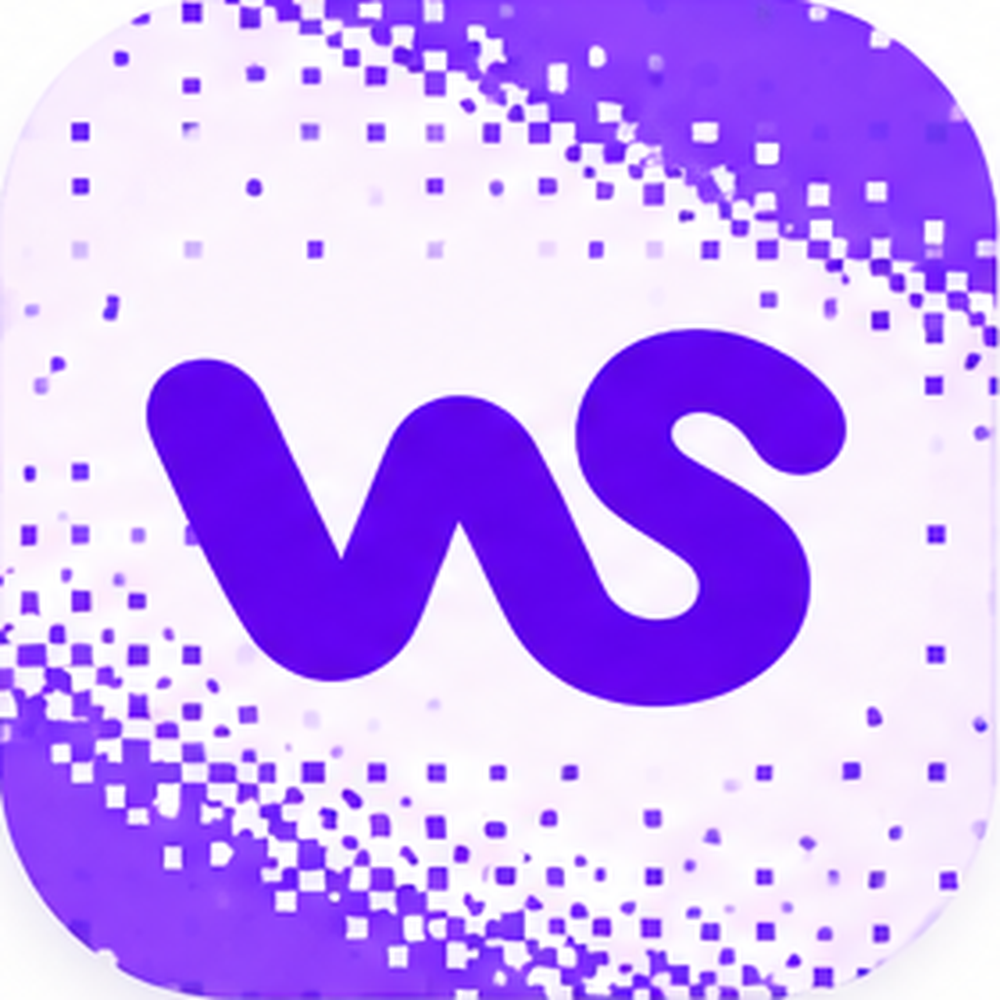

 

### We build things that make you say *whoa.*

**Independent creative development studio · Web experiences · Motion · macOS apps**

Beautiful interfaces. Thoughtful interactions. Useful software.

---

## Hey, we're Whoa Studio 👋

**Whoa Studio** is a design-driven studio creating websites, motion experiences, and native apps—with a special love for macOS.

We believe the best digital products don't have to choose between **craft and function**. They should feel fast, intuitive, polished, and a little delightful.

We build for clients, makers, and the open-source community.

## What we do

| 🌐 Web | ✨ Motion |  Apps |
| :--- | :--- | :--- |
| Modern websites and expressive digital experiences, built with care for performance and accessibility. | Micro-interactions, transitions, and motion that make interfaces feel alive. | Native-feeling tools and macOS experiences focused on simplicity, speed, and detail. |

## Things we're exploring

**⌨️ Whoa Type**  
A macOS typing experience with personality, including keyboard sound exploration.

**🗄️ Whoa Database**  
A native database management app for macOS, with a focus on a distinctive and approachable interface.

*These are studio projects in development; explore our repositories for what's available publicly.*

## Open by default 💜

We love the open-source ecosystem. When we can, we share experiments, useful tools, and the lessons learned along the way. Contributions, feedback, and thoughtful ideas are welcome.

## Our approach

- **Design with intent.** Every pixel and interaction should have a reason.
- **Build for real people.** Clarity and usability come first.
- **Sweat the details.** Small touches make software feel exceptional.
- **Keep learning in public.** Experiment, share, improve, repeat.

---

### Have something exciting in mind?

We're interested in thoughtful collaborations, useful open-source projects, and ambitious digital ideas.

**Explore our repositories · Open an issue in a relevant project · Get in touch through our organization profile**

Made with care, curiosity, and a little bit of whoa. 💜

